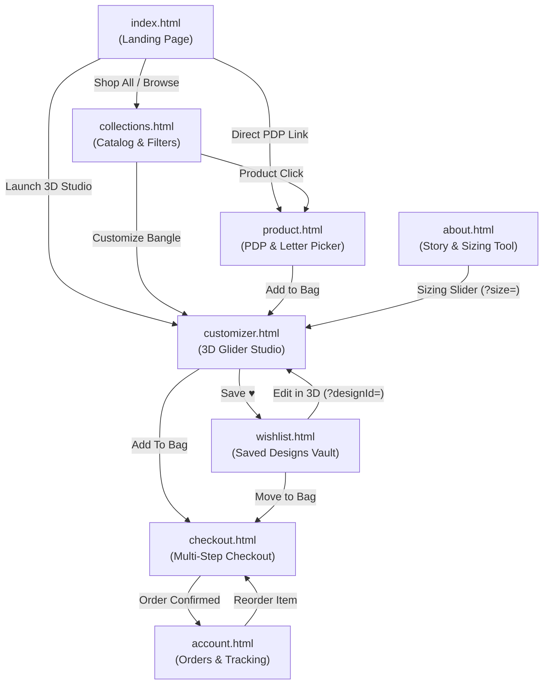

# ELISE PAIGE FINE JEWELRY & 3D GLIDER ATELIER
## Complete Project Handover, Architecture & Roadmap Documentation

> **Document Purpose:** This document is the single source of truth for the **ELISE PAIGE** luxury jewelry e-commerce web platform and interactive 3D Glider Bangle Customizer. Any developer or AI agent resuming work on this repository should read this document first to understand the system architecture, mathematical formulas, state machine, current completion status, and responsive design roadmap.

---

## 1. Project Overview & Brand Identity

- **Brand Name:** ELISE PAIGE • Fine Jewelry Atelier
- **Product Spotlight:** *Personalized Glider Charm Bangle™* — a patented luxury bangle with sliding cutout charms that glide smoothly along precision recessed tracks on the outer perimeter.
- **Design Aesthetic:** High-end Parisian/New York atelier styling.
  - **Colors:** Porcelain/Warm Cream (`#faf9f6`, `#f4f1ea`), Deep Obsidian Black (`#1b1b1b`), Atelier Warm Gold (`#ecbe54`, `#9c7116`), Soft Stone (`#e6e3dc`).
  - **Typography:** *Cormorant Garamond* (Editorial Headings), *Montserrat* (Geometric Sans UI), *Cairo* (Arabic RTL support).
- **Core Technology Stack:**
  - Modern Semantic HTML5 & Vanilla CSS3 (Custom design system tokens).
  - Vanilla Modular JavaScript (ES Modules, zero external frameworks like React/Vue).
  - **Three.js (r160)** via browser ES importmaps (`three`, `OrbitControls`, `GLTFExporter`, `RoomEnvironment`).
  - Client-side persistent state storage engine using `localStorage`.

---

## 2. Directory Structure & File Map

```text
jewelry-3d-bangle-customizer/
│
├── index.html                   # Luxury Editorial Landing Page (Hero, 3D Spotlight, Best Sellers)
├── collections.html             # Filterable Jewelry Catalog (Categories, Metals, Search, Sort)
├── product.html                 # Dynamic Product Detail Page (?id=...) with Review System
├── customizer.html              # 3D Dual-Track Glider Bangle WebGL Studio (?designId=, ?cartUid=)
├── wishlist.html                # Wishlist & Saved 3D Custom Designs Vault (with Token Previews)
├── checkout.html                # Full Multi-step Checkout & Printable Atelier Confirmation Receipt
├── account.html                 # Collector Account, 5-Stage Order Tracking & Quick Reorder
├── about.html                   # Atelier Craftsmanship Story & Interactive Wrist Sizing Tool
│
├── css/
│   └── styles.css               # Global Storefront Design System (Tokens, Header, Cart Drawer, Footer)
│
├── js/
│   ├── db.js                    # Seed Database (13 SKUs, Metals, Sizes, Charms, Reviews, Initial Order)
│   ├── store.js                 # State Management Engine (Cart, Promos, Wishlist, User, Orders)
│   └── layout.js                # Shared Header, Announcement Bar, Search Modal, Slide-out Cart Drawer
│
├── assets/
│   ├── images/                  # Bespoke High-Resolution Studio & Editorial Photography
│   │   ├── hero_editorial.jpg           # Landing hero banner
│   │   ├── craftsmanship_editorial.jpg  # Craftsmanship split section
│   │   ├── bangle_gold_studio.jpg       # 14K Gold Bangle studio shot
│   │   ├── bangle_silver_studio.jpg     # 925 Silver Bangle studio shot
│   │   ├── bangle_rose_studio.jpg       # 14K Rose Gold Bangle studio shot
│   │   ├── necklace_pendant_studio.jpg  # Pavé Heart Necklace shot
│   │   ├── earrings_huggie_studio.jpg   # Diamond Huggies shot
│   │   └── ring_solitaire_studio.jpg    # Solitaire Ring shot
│   │
│   └── charms/                  # 86 Transparent Alpha-Extracted 3D Cutout PNG Charms
│       ├── bee_gold.png, martini_gold.png, cherries.png, heart_gold.png, eye_gold.png, star_gold.png
│       ├── letter_[a-z]_gold.png        # Solid Gold Letters (A-Z)
│       ├── letter_[a-z]_pave.png        # Diamond Pavé Letters (A-Z)
│       └── num_[0-9]_gold.png           # Solid Gold Numbers (0-9)
│
├── glider-charm-bangle.obj       # Mathematical 3D CAD mesh export (18,072 verts, 17,988 triangles)
├── glider-charm-bangle.mtl       # OBJ Material definition
├── PROJECT_HANDOVER.md          # THIS ARCHITECTURE & HANDOVER FILE
└── README.md                    # Quick-start instructions & promo codes
```

---

## 3. The 3D Glider Customizer Engine (`customizer.html`)

### A. Procedural CAD Bangle Geometry
- **Ellipse Formula:** Semi-major axis $A \approx 28.5\,\text{mm} + 2.4\,\text{mm} - 0.55\,\text{mm} \approx 30.35\,\text{mm}$, Semi-minor axis $B \approx 24.0\,\text{mm} + 2.4\,\text{mm} - 0.55\,\text{mm} \approx 25.85\,\text{mm}$.
- **Dual Tracks (Front & Back):**
  - **Front Track:** Centered at angle $-\frac{\pi}{2}$ (facing $-Y$, towards default camera position $(0, -0.15, 0.045)$). Spans $\theta \in [-0.85\pi, -0.15\pi]$ ($70\%$ perimeter sweep).
  - **Back Track:** Centered at angle $+\frac{\pi}{2}$ (facing $+Y$, towards back camera position $(0, 0.15, 0.045)$). Spans $\theta \in [+0.15\pi, +0.85\pi]$.
- **Hardware Details:** Solid hinge clasps with 3 knuckle cylinders, inner 925/14K hallmark stamp decal.
- **PBR Metallic Alloys:**
  - `14K Yellow Gold`: Color `#e3b552`, Roughness `0.20`, Metalness `0.95`.
  - `925 Sterling Silver`: Color `#e8e8e8`, Roughness `0.18`, Metalness `0.98`.
  - `14K Rose Gold`: Color `#e09f87`, Roughness `0.22`, Metalness `0.94`.

### B. Standalone 3D Cutout Charms (No Frame / Pure Silhouette)
- **Problem Solved:** Traditional square/framed charms looked clunky. The user requested pure standalone cutout charms matching real jewelry.
- **10-Layer Micro-Extrusion:** Each charm is rendered with 10 stacked micro-layers ($0.65\,\text{mm}$ total physical depth) using the alpha transparency of the PNG, tinted with the active metal alloy on the lateral edges, plus a 100% crisp front face decal.
- **90° Step Rotation:** Clicking the rotation button rotates the charm pivot smoothly by $+90^\circ$ ($0^\circ \to 90^\circ \to 180^\circ \to 270^\circ$).

### C. 3D Raycasting, Grabbing & Physics
- **Capture-Phase Pointer Binding:** `renderer.domElement.addEventListener('pointerdown', ..., { capture: true })` intercepts clicks before `OrbitControls` sees them, stopping camera rotation and preventing `setPointerCapture` conflicts.
- **Accurate NDC Coordinates:** `getPointerNDC()` calculates mouse coordinates directly against `renderer.domElement.getBoundingClientRect()`.
- **Continuous Unwrapped Angle Math:** When sliding along the track, angles are calculated relative to `centerAngle` ($-\frac{\pi}{2}$ front, $+\frac{\pi}{2}$ back), avoiding sudden $\pm\pi$ sign flips:
  $$\Delta\theta = \text{atan2}(y/B, x/A) - \theta_{\text{center}}$$
  $$\text{wrapped to } [-\pi, \pi]$$
  $$t = 0.5 + \frac{\Delta\theta}{0.70\pi}$$
- **Collision & Reordering:**
  - `MIN_SPACING = 0.082`, `MIN_S = 0.10`, `MAX_S = 0.90`.
  - When dragging past a neighbor, charms swap positions and push adjacent charms so they never intersect.
- **Physical Lift Animation:** While dragged, the active charm lifts $1\,\text{mm}$ outward along the normal vector ($z$ offset), snapping back upon release.
- **3D CAD Export:** Built-in `GLTFExporter` bundles the full scene into a binary `.GLB` file containing the bangle and all active charms, ready for Blender, Rhino, or 3D printing.

---

## 4. State Management Engine (`EP_STORE` & `EP_DB`)

The state engine in `js/store.js` is fully reactive via a publish/subscribe pattern (`EP_STORE.subscribe(fn)`). It manages:

| Domain | Key Storage Methods | Data Structure / Details |
|---|---|---|
| **Cart** | `addToCart`, `updateCartQty`, `removeFromCart`, `clearCart` | Handles both standard catalog products and custom 3D bangles (`frontCharms`, `backCharms`, `size`, `metal`). |
| **Promos** | `applyPromo`, `removePromo`, `getTotalsBreakdown` | `ELISE15` (15% off), `ATELIER20` (20% off $500+), `WELCOME50` ($50 off $300+). |
| **Wishlist** | `toggleProductWishlist`, `saveCustomDesignToWishlist`, `getWishlistItemById` | Stores saved 3D designs with charm arrays for full hydration via `customizer.html?designId=...`. |
| **Auth** | `signIn`, `signOut`, `updateUserProfile`, `getUser` | Demo collector profile (persisted in `localStorage`). |
| **Orders** | `placeOrder`, `getOrders`, `getOrderByNumber` | Auto-calculates tax, discounts, and generates `#EP-2026-XXXX` order with 5 fulfillment stages. |
| **Reviews** | `getReviews`, `addReview` | Persists user reviews with star ratings and timestamps. |

---

## 5. Page-by-Page Breakdown & Cross-Navigation



1. **`index.html` (Landing):**
   - Editorial Hero with direct CTA to 3D Customizer.
   - Interactive 3D Metal Showcase Spotlight (`Yellow Gold`, `Silver`, `Rose Gold`).
   - Signature Best Sellers with Quick Add & Wishlist toggle.
   - Cutout Charms Strip showcasing standalone symbols and initials.
   - Craftsmanship split section & verified client testimonials.
2. **`collections.html` (Catalog):**
   - Filter pills: All, Bangles, Charms, Necklaces, Earrings, Rings.
   - Metal filter pills (`All`, `14K Yellow`, `925 Silver`, `14K Rose`).
   - Live real-time search input + sorting dropdown (Price, Name, Rating).
   - URL hydration (`?cat=...&metal=...&search=...`).
3. **`product.html` (Product Detail):**
   - Gallery image synced to selected metal finish.
   - Dynamic initial letter grid (A–Z) for `charm-pave-letter`.
   - Size grid (`XS`–`L`) with direct link to Size Guide.
   - Complimentary personalized gift message textarea.
   - Live review submission form with instant persistence.
4. **`customizer.html` (3D Studio):**
   - Dual-track customization stepper: Step 1 (Front Track) $\to$ Step 2 (Back Track) $\to$ Step 3 (Review & Order).
   - Size selection (`XS`, `S`, `M`, `L`) and Metal alloy selection.
   - Draggable active charm tray with 90° rotation, swapping, removal, and auto-centering.
   - Save to Wishlist (`?designId=...`) and Edit Cart item (`?cartUid=...`).
5. **`wishlist.html` (Saved Designs):**
   - Displays both saved catalog items and custom 3D bangles.
   - Custom bangles render miniature charm tokens for both front and back tracks.
   - One-click `"Edit in 3D"` links back into `customizer.html` with full state restored.
6. **`checkout.html` (Checkout & Receipt):**
   - Pre-fills shipping address from `EP_STORE.getUser()`.
   - Shipping options: Insured Standard (Free over $150) vs DHL Express ($25).
   - Payment tabs: Credit Card, Apple Pay, Cash on Delivery.
   - Promo code input with instant validation.
   - Generates complete printable atelier receipt with `#EP-2026-XXXX`.
7. **`account.html` (Collector Account):**
   - One-click instant demo login/logout.
   - 5-stage graphical progress tracker for placed orders (*Confirmed $\to$ Handcrafting $\to$ Quality Check $\to$ Insured Transit $\to$ Delivered*).
   - Safe `reorderItem(orderNumber, itemIndex)` button.
   - Editable shipping profile form.
8. **`about.html` (Story & Sizing):**
   - Brand heritage and ethical sourcing principles.
   - Interactive wrist circumference slider ($13.0\,\text{cm}$ to $19.0\,\text{cm}$) that calculates the exact size and has a button: `"Launch 3D Customizer in Size [M]"`.
   - Sizing chart table and collapsible FAQ accordions.

---

## 6. Responsive Design Plan & Breakpoints

### Current Implementation Status
- **Desktop ($\ge 993\,\text{px}$):**
  - Viewport-locked layout (`height: 100vh; overflow: hidden;` on body).
  - Left panel: 3D WebGL viewport flexes to occupy remaining space, keeping canvas aspect ratio 1:1 with container via `ResizeObserver`.
  - Right panel: 450px sidebar with internal smooth scrolling (`sidebar-content`), keeping the primary checkout button fixed in view.
- **Tablet & Mobile ($\le 992\,\text{px}$):**
  - Layout stacks vertically (`flex-direction: column; overflow: visible;`).
  - Viewport height sets to `52vh` (min `360px`), allowing full 3D interaction.
  - Sidebar expands to 100% width below the viewport.
  - Global Header switches to mobile hamburger menu drawer (`#mobileNavDrawer`).

### Mobile Roadmap & Completed Milestones
1. **Touch Gesture Differentiation:**
   - On mobile touch screens, 1-finger drag on a charm slides it smoothly along the rail with automatic pointer capture and lift effect, while 1-finger drag on empty canvas rotates the camera, and 2-finger pinch zooms without interference.
2. **Sticky Mobile Action Bars (Completed):**
   - `customizer.html`: Atelier Floating Remote Action Dock (`#mobileStickyActionBar`) keeps track counts, total price, 180° flip button, and Add to Bag fixed at the screen bottom.
   - `product.html`: High-end PDP Sticky Action Bar (`#pdpMobileStickyBar`) slides up via `IntersectionObserver` when scrolling past the main CTA, displaying live thumbnail, title, selected finish/size/initial, and "Add to Bag".
3. **Mobile Bottom Sheet & Viewport Adaptability:**
   - On small screens ($\le 600\,\text{px}$), horizontal scroll trays and compact responsive grids optimize screen real estate for the 3D WebGL canvas.

---

## 7. How to Run & Verify the Project

### Running the Full Laravel + MySQL Stack (Recommended)
1. **Start MariaDB / MySQL Server:**
   ```powershell
   & "C:\xampp\mysql\bin\mysqld.exe" --defaults-file="C:\xampp\mysql\bin\my.ini" --console
   ```
2. **Start Laravel Development Server:**
   ```powershell
   & "C:\xampp\php\php.exe" "e:\niche-jewelry\artisan" serve --host=127.0.0.1 --port=8000
   ```
3. **Open in Browser:**
   - Storefront Arabic (Default RTL): **`http://127.0.0.1:8000/ar`**
   - Storefront English (LTR): **`http://127.0.0.1:8000/en`**
   - 3D Interactive Atelier: **`http://127.0.0.1:8000/ar/atelier`**
   - Collections Catalog: **`http://127.0.0.1:8000/ar/collections`**
   - Product Page: **`http://127.0.0.1:8000/ar/product/glider-14k-gold`**
   - Checkout Flow: **`http://127.0.0.1:8000/ar/checkout`**
   - Collector Account: **`http://127.0.0.1:8000/ar/account`**
   - Wishlist Vault: **`http://127.0.0.1:8000/ar/wishlist`**
   - Heritage & About: **`http://127.0.0.1:8000/ar/about`**
   - **Full Admin Panel Suite:** **`http://127.0.0.1:8000/admin`**
     - Products CRUD: `http://127.0.0.1:8000/admin/products`
     - 3D Charms Management: `http://127.0.0.1:8000/admin/charms`
     - Orders & 3D Specs: `http://127.0.0.1:8000/admin/orders`
     - Currency & Store Settings: `http://127.0.0.1:8000/admin/settings`

### Running the Static Node Server (Alternative)
```bash
node server.js
# Open http://localhost:8080/index.html
```

### Demo Promo Codes for Testing
- **`NICH15` / `ELISE15`**: 15% off entire order.
- **`ATELIER20`**: 20% off orders over $500.
- **`WELCOME50`**: $50 off orders over $300.

---

## 8. Development Roadmap Status

| Feature / Track | Status | Implementation Details |
|---|---|---|
| **Quiet Luxury Hero Redesign** | ✅ Complete | Minimalist editorial aesthetic, removed spinning vinyl turntable and AI chips, high-res black panther & 14K gold diamond bangle, responsive mobile layout. |
| **Storefront Layout & Image Bug Fix** | ✅ Complete | Consolidated component styles into `css/styles.css`, fixed all relative asset paths (`/ar/...` 404 issue) to absolute paths across all Blade views. |
| **Full Bilingual Blade System** | ✅ Complete | Complete suite of views (`home`, `customizer`, `collections`, `product`, `checkout`, `account`, `wishlist`, `about`) with seamless Arabic RTL and English LTR support. |
| **Dual Currency Engine (USD & KWD)** | ✅ Complete | Dedicated `price_kwd` schema (3 decimals), `CurrencyService`, `@currency` Blade directive, live currency switcher pill (`$ USD` / `د.ك KWD`), and admin manual/auto pricing. |
| **Comprehensive Admin Panel Suite** | ✅ Complete | Admin layout with Cartier/Tiffany dark luxury styling, Product CRUD with image uploads, Charm CRUD with active drawer toggles, Order Inspector with 3D specs, and Store Settings. |
| **3D Bangle CAD & Dual Rails** | ✅ Complete | Procedural ellipse, front/back channels, 925/14K hallmark, PBR alloys. |
| **Pure Cutout Silhouette Charms** | ✅ Complete | 85 standalone alpha charms, 10-layer micro-extrusion, 90° rotation, collision swap. Fixed all 33 letter/number thumbnail paths. |
| **Atelier Inner Engraving Studio** | ✅ Complete | Real-time 3D canvas texture (1024×128) with debossed metallic relief, 3 typography fonts (Roman, Script, Modern), "Inside" camera preset, cart/wishlist/checkout receipt sync. |
| **Bespoke Charm PNG Uploader** | ✅ Complete | Dropzone file reader, instant transparent cutout generation, 10-layer physical 3D mesh placed on track with pricing ($65) and GLB export. |
| **AR Try-On & Virtual Wrist Studio** | ✅ Complete | Interactive wrist draping simulator with 3 skin tones (Fair, Olive, Deep), dynamic QR code for instant mobile AR QuickLook, 3D GLB asset export. |
| **PDP Sticky Mobile Action Bar** | ✅ Complete | IntersectionObserver trigger on `product.html`, thumbnail, dynamic metal/size specs, price & bag trigger. |
| **Accordion Stepper Customizer** | ✅ Complete | Progressive disclosure 4-step accordion (Metal & Size $\to$ Charms $\to$ Engraving $\to$ Review), summary chips, kept floating action dock intact. |
| **Horizontal Charm Orientation** | ✅ Complete | Restricted rotation to realistic horizontal orientation: Upright (0°), Facing Right (90°), Facing Left (270°), eliminating awkward upside-down positions. |
| **Luxury Order Tracker Concierge** | ✅ Complete | Tiffany/Cartier inspired 5-stage milestone timeline, animated gold progress connection bar, milestone icons, dual currency ($ / KWD). |
| **Zero-404 Route Interconnection** | ✅ Complete | `getRoute()` & `getProductHref()` dynamic route generator in `js/layout.js`, full Laravel route helpers in all Blade views, and graceful legacy `.html` redirects in `routes/web.php`. |
| **MySQL Database Integration** | ✅ Complete | Connected to local MariaDB/MySQL `niche_jewelry` database, running migrations and seeders cleanly. |

---
*Authored by Antigravity Atelier Engineering • Ready for immediate continuation in any future workspace or chat session.*
